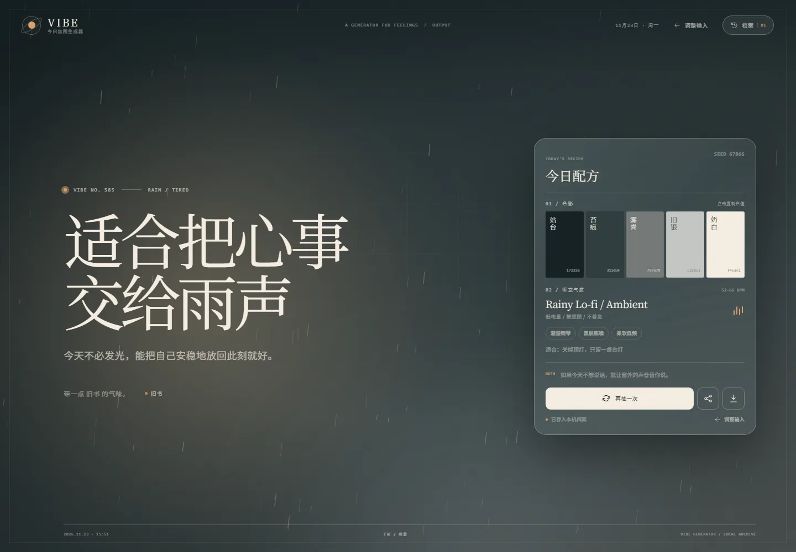
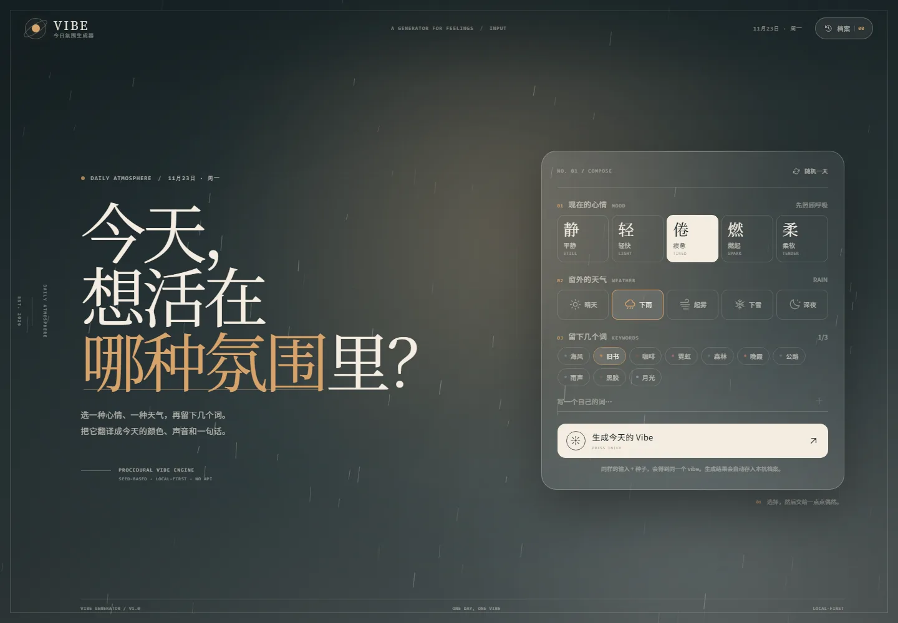

# 今日 Vibe 氛围生成器

> 把今天的天气和心情，翻译成颜色、声音和一句话。

一个纯前端、可复现的氛围生成器。打开页面，它会读取你所在位置的实时天气；你选择此刻的心情、留下几个私人关键词，它会把这三件事翻译成一套配色、一段渐变、场景粒子、一句文案和一份听觉气质，最后落成一张可以保存、分享、重新打开的氛围卡。

它不是天气 App，也不是配色工具。天气只是入口，真正被生成的是你此刻看世界的方式。

[在线 Demo](https://chencu-vinegar.github.io/vibe-generator/) · [GitHub 仓库](https://github.com/Chencu-vinegar/vibe-generator) · [设计思路](#设计思路) · [映射系统](#映射系统) · [本地运行](#本地运行) · [部署到-github-pages](#部署到-github-pages)



## 概念

天气 App 告诉你今天几度、下不下雨。这个项目想追问的是：

> 同样的 16°C 和一场小雨，落在不同的心情里，会长成什么样？

所以它把输入拆成四种不同性质的东西：

- **天气**：客观的、窗外的、正在发生的
- **心情**：主观的、身体里的、难以言说的
- **关键词**：私人的、偶然的、带气味的
- **种子**：微小的、命运的、让同一个今天只发生一次

生成结果不是一份天气报告，而是一张“今天的切片”：能看、能听、能带走，也能在很久之后重新打开。

## 它是什么

不是随机换色，而是一套“输入 → 气氛”的映射系统：

- **心情**：静 / 轻 / 倦 / 燃 / 柔
- **天气**：浏览器定位 → 实时天气 → 自动映射为晴 / 雨 / 雾 / 雪 / 夜；定位失败时用网络位置，再失败可手动调整
- **关键词**：预设 10 个 + 最多 3 个自定义词
- **输出**：5 色色板、动态渐变、Canvas 粒子、氛围文案、声音配方、生成手记、可分享 URL、可下载 1080×1440 海报
- **历史**：自动存入浏览器 LocalStorage，显示累计 / 最常心情 / 最常色 / 最近 14 天；可恢复、删除、清空

首次打开会请求一次定位权限。页面展示当前温度、体感温度、天气现象和城市；定位只用于获取天气，**坐标不会写入 LocalStorage，也不会带到分享链接里**。

界面采用编辑部海报式的排版：大字号中文衬线标题、极细边框、低饱和动态光晕和克制的微型排版。配色、粒子和文案会随着输入实时切换，但真正生成后的结果由 **输入 + 随机种子** 决定。

## 设计思路

这个项目想解决的不是“怎么随机出很多颜色”，而是三个更具体的问题：

1. 怎么让天气 API 的数据不变成仪表盘，而成为情绪的一部分？
2. 怎么让随机生成有惊喜，但不失控、不像老虎机？
3. 怎么让一个单页工具看起来像一件完整的作品，而不是功能的集合？

对应的四条设计原则是：

> **氛围先于信息。约束先于随机。体验先于功能。可复现先于无限变化。**

### 1. 氛围先于信息

页面不是仪表盘。温度只出现在一张小卡里，天气现象缩成一行小字；真正占据视觉中心的是标题、光线和留白。

用户先“感到”一个氛围，再读到解释。所以视觉顺序是：

```text
光 → 标题 → 一句文案 → 配方与数据
```

这也是为什么结果页只有一位视觉主角：两行大字。色板、BPM、seed 都退到右侧的「今日配方」里，像海报背面的制作信息，而不是产品看板。

### 2. 把随机关进笼子

纯随机很容易产生“看起来都差不多”的结果。这里的设计是：**先设计可能性空间，再让种子在里面挑一个版本。**

- 天气决定色板家族：5 种天气 × 3 组色板，共 15 个基底
- 心情只做微调：改变饱和度、明度和少量色相，不重新发明一套颜色
- 种子控制：选择哪组色板、渐变角度、粒子密度、文案和局部变化
- 文案来自手写词库，不做“形容词 + 名词”的机器拼贴

所以随机不是“乱”，而是**在设计师允许的范围内，替今天做一个不重复的选择**。

### 3. 一次输入，打通五种感知

如果颜色、粒子、文案和歌单各自随机，结果会散。这里让同一个输入同时影响多个通道：

| 感知维度 | 由什么决定 | 具体表现 |
| --- | --- | --- |
| 光 | 天气 | 色板家族、背景明暗、粒子类型 |
| 温度 | 心情 | 饱和度、色相偏移、文案语气 |
| 触感 | 关键词 | 小面积色点、签名句里的气味 |
| 声音 | 天气 + 心情 | 音乐类型、BPM 区间、质感关键词 |
| 节奏 | 种子 | 色板变体、渐变角度、粒子速度、文案选择 |

这样用户看到的不是一个“随机结果”，而是一个内部一致的小世界。

### 4. 界面是一张会呼吸的海报

视觉系统刻意避开了常见的“深色玻璃卡片 + 霓虹渐变”模板：

- 中文衬线大字与微型等宽标签形成尺度对比
- 1px 细线、页边距和编号系统，制造印刷品的感觉
- 低饱和动态光晕、颗粒噪点和缓慢粒子，让背景有空气感
- 结果页不是“卡片堆叠”，而是一张完整构图；右边的小面板只是装裱信息

界面对结果的态度是**装裱**，不是展示更多的 UI。

### 5. 把失败路径也设计进去

真实天气是外部依赖，必须接受它会失败。

```text
浏览器定位 → 网络位置 → 手动选择
```

- 定位被拒绝：自动使用网络出口位置，界面标注「网络位置」
- 天气服务超时：切换到备用源
- 全部失败：展开手动选择，但不阻塞生成
- 15 分钟自动刷新一次，也可以随时手动刷新

失败时没有红色报错弹窗，只有天气卡里的一行状态。用户永远可以继续完成今天的那张卡。

### 6. 可复现的偶然

`generateVibe(input, seed)` 是纯函数：同样的输入和 seed，永远得到同一个结果。

这不是技术细节，而是作品态度：

- “再抽一次”是换一个 seed，不是把所有东西打乱
- 分享链接里带 seed，打开就能回到同一个今天
- 历史记录只存 `input + seed + createdAt` 和一条索引 id，不存 DOM、图片或坐标
- 种子是这张氛围卡的指纹，不是抽奖记录

**浪漫但不神秘**，是这个项目对随机生成的理解。

### 7. 让系统解释自己

结果不是黑箱。结果面板右上角的 **WHY THIS VIBE** 可以展开一张「生成手记」，把这次选择摊开：

- 天气如何进入色板家族
- 心情把饱和度、明度和色相调到了哪里
- 选中了第几组色板、渐变角度是多少
- 粒子密度和速度如何被决定
- 文案来自哪个手写词库

这不是开发者调试面板，而是作品的注释。它让“随机感”变成“可理解的偶然”，也让评审能看到规则本身的设计，而不只是最终那张图。


## 映射系统

核心不是随机数，而是**约束**。

| 输入 | 色彩 | 粒子 | 文案语气 | 声音气质 |
| --- | --- | --- | --- | --- |
| 雨 + 倦 | 深海蓝、湿墙灰、暖瓷 | 斜雨 | 低电量、被照顾 | Rainy Lo-fi / Ambient，52–66 BPM |
| 晴 + 轻 | 米白、天光青、陶土 | 尘埃光点 | 松弛、明亮、有风 | Indie Folk / City Pop，100–124 BPM |
| 雾 + 静 | 雾白、苔灰、松针 | 大颗粒雾团 | 留白、内省 | Dream Pop / Slowcore，60–76 BPM |
| 雪 + 柔 | 雪白、冰蓝、冷杉 | 慢速雪点 | 柔软、安静 | Ambient / Neo-Classical，48–64 BPM |
| 夜 + 燃 | 墨夜、霓虹、琥珀 | 上升余烬 | 带电、出发 | Neo-Soul / Bedroom Pop，82–108 BPM |

真实天气进入生成器之前会先被翻译成这五种“视觉天气”之一：

| 实时天气 | 视觉天气 |
| --- | --- |
| 晴、晴间多云 | 白天为晴，夜间为夜 |
| 多云、阴、薄雾、烟霾 | 雾 |
| 毛毛雨、雨、阵雨、雷雨 | 雨 |
| 小雪、中雪、大雪、雨夹雪、冰粒 | 雪 |

天气代码来自 wttr.in 的 WWO 天气码和 Open-Meteo 的 WMO 天气码。这样视觉系统保持稳定，同时保留真实天气信息。

## 交互设计

整个体验只有三个动作：

1. **生成**：自动读取实时天气，选择心情、补充关键词 → 生成今天的 Vibe
2. **再抽一次**：保留输入，只换 seed，得到同一氛围下的另一种可能
3. **找回**：打开「档案」，恢复某一天；或复制分享链接，在另一台设备打开同一个 vibe

界面刻意没有做无限信息流。一次只给一个今天；如果还想要另一个版本，就主动点“再抽一次”。这让生成更像一个动作，而不是刷不完的列表。

### 档案不是列表

「档案」也不只是历史列表。抽屉顶部会汇总累计生成数、最常出现的心情和最常使用的颜色，下面是一条最近 14 天的色带；点击有颜色的日期，就能恢复那天的 Vibe。

这让历史记录从“存起来的结果”变成“可以回看的个人氛围记录”。




<p>
  
</p>

## 导出氛围卡

生成结果可以一键导出为 1080 × 1440 的海报：渐变底、标题、当日文案、完整色板、声音配方和 seed 都画在一张 Canvas 上，不依赖截图插件。


## 技术实现

- **确定性生成**：`generateVibe(input, seed)` 是纯函数，生成逻辑与 UI 分离。
- **实时天气**：优先浏览器定位 → wttr.in；定位不可用时用 wttr.in 的网络位置；天气服务失败时再兜底 Open-Meteo。
- **逆地理**：BigDataCloud 返回中文城市名，避免把经纬度直接展示给用户。
- **场景主题**：生成器输出 CSS 变量，颜色变化通过 `@property` 平滑过渡。
- **粒子**：Canvas 2D 手写，没有粒子库；不同天气对应不同运动方式。
- **存储**：LocalStorage 只保存 `input + seed + createdAt` 和一条索引 id，其中天气只存 `clear / rain / mist / snow / night` 这一层，不存坐标、城市或温度。
- **分享**：结果 URL 形如 `?mood=rain&weather=rain&kw=旧书&seed=72288`，打开即恢复，不需要后端。
- **性能**：粒子数量有上限，DPR 上限 2，页面隐藏时暂停；支持 `prefers-reduced-motion` 降级。

## 技术栈

- React 19 + TypeScript
- Vite 7
- 原生 CSS（CSS 变量 + `@property` 过渡 + 媒体查询）
- Canvas 2D（无粒子库）
- LocalStorage（版本化 key：`vibe-generator:v1:history`）
- 实时天气：wttr.in（主）+ Open-Meteo（备）
- 逆地理城市名：BigDataCloud
- 无后端、无 API Key、无外部图片/字体依赖；天气请求直接从浏览器发出

## 设计取舍

这个项目有意没有做以下几件事：

- **没有登录和云同步**：历史保存在浏览器里，分享通过 URL 完成。少一个后端，也少一层隐私负担。
- **没有真实音乐播放**：歌单是“听觉气质”推荐，不是音乐平台 API。视觉和文字已经足够承担氛围，不需要再引入版权和播放器状态。
- **没有接入大模型**：文案和视觉来自本地手写词库与规则，结果是可复现的。AI 不是这个项目的必要条件。
- **没有做多页面**：输入、结果、档案、分享都在一个连续的界面里。多一个页面，就多一次注意力切换。
- **没有堆输入项**：没有湿度、风速、能量滑杆。天气自动来，心情和关键词已经足够构成一个今天。

## 本地运行

要求 Node.js 22+，推荐 24。

```bash
pnpm install
pnpm dev
```

打开终端提示的本地地址。生产构建：

```bash
pnpm build
pnpm preview
```

> 如果 `pnpm` 提示构建脚本被拦截，运行 `pnpm approve-builds` 并允许 `esbuild`。仓库内的 `pnpm-workspace.yaml` 已经为本项目配置好 hoisted 依赖和 esbuild 构建许可。

## 部署到 GitHub Pages

线上地址：

**https://chencu-vinegar.github.io/vibe-generator/**

部署由 [`.github/workflows/deploy.yml`](.github/workflows/deploy.yml) 自动完成：

1. 推送到 `main`。
2. GitHub Actions 安装依赖并执行 `pnpm build`。
3. 构建产物部署到 GitHub Pages。

如果复用本项目并改名仓库，需要同步修改 `vite.config.ts` 里的 `base`：

```ts
base: command === 'build' ? '/vibe-generator/' : '/'
```

项目没有使用前端路由，刷新和分享链接都不需要额外的 404 fallback。

## 目录结构

```text
src/
├─ components/
│  ├─ LiveWeatherPanel.tsx  # 实时天气卡 + 手动兜底
│  └─ ...                   # 输入页、结果页、粒子、档案
├─ data/vibes.ts            # 心情/天气/色板/文案/声音映射
├─ hooks/
│  └─ useLiveWeather.ts     # 定位/刷新/15 分钟自动更新
├─ lib/
│  ├─ weather.ts            # wttr.in + Open-Meteo + 逆地理
│  ├─ generator.ts          # 纯函数生成器 + 场景 CSS 变量
│  ├─ random.ts             # FNV-1a + mulberry32，确定性随机
│  ├─ storage.ts            # 版本化 LocalStorage
│  ├─ url.ts                # 分享参数读写
│  ├─ export.ts             # 1080×1440 Canvas 海报
│  └─ color.ts              # HSL 调整与对比色
├─ App.tsx
└─ styles.css
```

## 已知限制

- 历史只存在当前浏览器，不会多设备同步；换域名后 LocalStorage 会另起一份。
- 歌单是“听觉气质”推荐，不是真实音乐播放或音乐平台 API。
- 没有接入大模型。文案和视觉来自本地策展的规则与词库，完全可复现；但实时天气需要网络。
- 天气数据和逆地理使用公开免费接口，偶尔可能超时或限流；应用会自动退回网络位置或手动选择，不阻塞生成。
- 浏览器定位被拒绝时，会用网络出口位置做近似天气，界面会标注“网络位置”，可手动改回你所在的城市天气。
- 首次打开会弹出浏览器定位授权；GitHub Pages 是 HTTPS，本地 `localhost` 也可以正常定位。
- 浏览器不支持 `@property` 时颜色切换会直接变化，不影响功能。
- 极端窄屏（<360px）下输入区需要纵向滚动，这是有意的移动端布局。

## 素材与许可

项目内的颜色、渐变、粒子、排版和文案均为本项目生成或手写；没有使用外部图片、专辑封面、歌词或商业字体。字体使用系统字体栈。

天气数据由 [wttr.in](https://wttr.in/) 提供（备源 [Open-Meteo](https://open-meteo.com/)），城市名由 [BigDataCloud](https://www.bigdatacloud.com/) 逆地理返回。它们都是公开免费接口，本项目没有把任何 API Key 写进前端。实时天气请求失败时，应用会保留手动选择路径。
