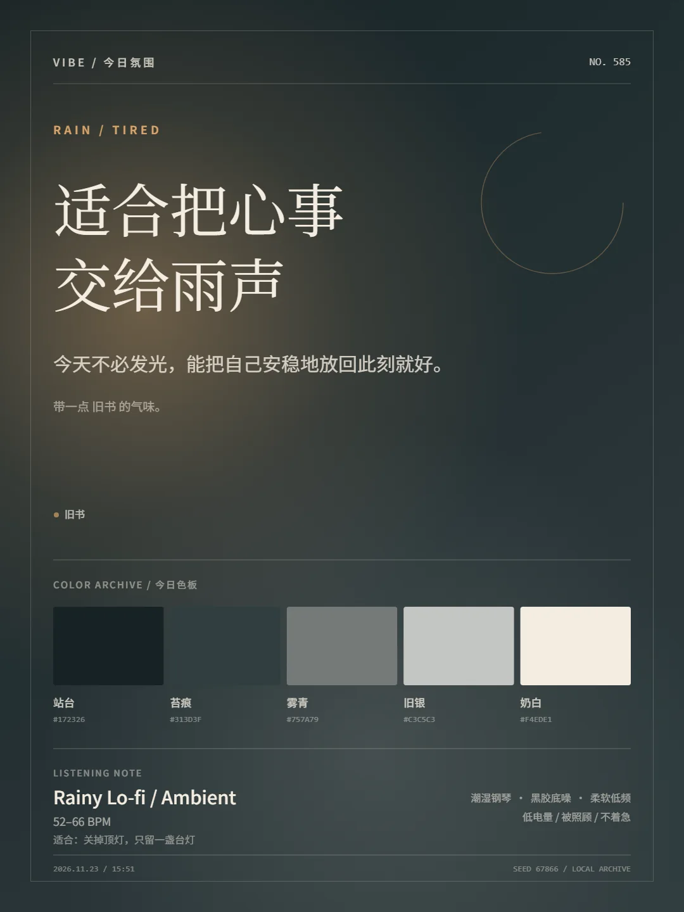

# 今日 Vibe 氛围生成器

> 把今天的心情，翻译成颜色、声音和一句话。

一个纯前端、可复现的程序化氛围生成器。打开页面，它会读取你所在位置的实时天气；选一种心情、留下几个关键词，得到今天的配色、渐变粒子、氛围文案、声音气质和一张可下载的氛围卡。

[在线 Demo](https://YOUR_NAME.github.io/vibe-generator/) · [设计方法](#设计方法) · [本地运行](#本地运行) · [部署到-github-pages](#部署到-github-pages)

> 把上面的 `YOUR_NAME` 换成你的 GitHub 用户名。第一次部署成功后再更新这里。


## 它是什么

不是随机换色，而是一套“输入 → 气氛”的映射系统：

- **心情**：静 / 轻 / 倦 / 燃 / 柔
- **天气**：浏览器定位 → 实时天气 → 自动映射为晴 / 雨 / 雾 / 雪 / 夜；定位失败时用网络位置，再失败可手动调整
- **关键词**：预设 10 个 + 最多 3 个自定义词
- **输出**：5 色色板、动态渐变、Canvas 粒子、氛围文案、声音配方、可分享 URL、可下载 1080×1440 海报
- **历史**：自动存入浏览器 LocalStorage，可恢复、删除、清空

首次打开会请求一次定位权限。页面展示当前温度、体感温度、天气现象和城市；定位只用于获取天气，**坐标不会写入 LocalStorage，也不会带到分享链接里**。

界面采用编辑部海报式的排版：大字号中文衬线标题、极细边框、低饱和动态光晕和克制的微型排版。配色、粒子和文案会随着输入实时切换，但真正生成后的结果由 **输入 + 随机种子** 决定。

## 三种使用循环

1. **生成**：自动读取实时天气，选择心情、补充关键词 → 生成今天的 Vibe
2. **再抽一次**：保留输入，只换 seed，得到同一氛围下的另一种可能
3. **找回**：打开「档案」，恢复某一天；或复制分享链接，在另一台设备打开同一个 vibe


<p>
  
</p>

## 导出氛围卡

生成结果可以一键导出为 1080 × 1440 的海报：渐变底、标题、当日文案、完整色板、声音配方和 seed 都画在一张 Canvas 上，不依赖截图插件。



## 设计方法

核心不是随机数，而是**约束**。

| 输入 | 色彩 | 粒子 | 文案语气 | 声音气质 |
| --- | --- | --- | --- | --- |
| 雨 + 倦 | 深海蓝、湿墙灰、暖瓷 | 斜雨 | 低电量、被照顾 | Rainy Lo-fi / Ambient，52–66 BPM |
| 晴 + 轻 | 米白、天光青、陶土 | 尘埃光点 | 松弛、明亮、有风 | Indie Folk / City Pop，100–124 BPM |
| 雾 + 静 | 雾白、苔灰、松针 | 大颗粒雾团 | 留白、内省 | Dream Pop / Slowcore，60–76 BPM |
| 雪 + 柔 | 雪白、冰蓝、冷杉 | 慢速雪点 | 柔软、安静 | Ambient / Neo-Classical，48–64 BPM |
| 夜 + 燃 | 墨夜、霓虹、琥珀 | 上升余烬 | 带电、出发 | Neo-Soul / Bedroom Pop，82–108 BPM |

真实天气进入生成器之前会先被翻译成这五种“视觉天气”之一：

| 实时天气 | 视觉天气 |
| --- | --- |
| 晴、晴间多云 | 白天为晴，夜间为夜 |
| 多云、阴、薄雾、烟霾 | 雾 |
| 毛毛雨、雨、阵雨、雷雨 | 雨 |
| 小雪、中雪、大雪、雨夹雪、冰粒 | 雪 |

天气代码来自 wttr.in 的 WWO 天气码和 Open-Meteo 的 WMO 天气码。这样视觉系统保持稳定，同时保留真实天气信息。

实现上有几个关键决定：

- **确定性**：`generateVibe(input, seed)` 是纯函数，相同输入和 seed 一定得到相同结果；偏好不做成“每次刷新都变”的随机页面。
- **实时天气**：优先浏览器定位 → wttr.in；定位不可用时用 wttr.in 的网络位置；天气服务失败时再兜底 Open-Meteo。
- **受控随机**：天气决定色板家族，心情微调饱和度与明度，seed 再控制变体、角度、粒子密度和文案选择。
- **只存种子**：LocalStorage 里只保存 `input + seed + createdAt`，其中天气只存 `clear / rain / mist / snow / night` 这一层，不存坐标、城市或温度。历史恢复时重新生成视觉，不存 DOM 或图片。
- **可分享**：结果 URL 形如 `?mood=rain&weather=rain&kw=旧书&seed=72288`，打开即恢复，不需要后端。
- **性能**：Canvas 粒子数量有上限，DPR 上限 2，页面隐藏时暂停；支持 `prefers-reduced-motion` 降级。

## 技术栈

- React 19 + TypeScript
- Vite 7
- 原生 CSS（CSS 变量 + `@property` 过渡 + 媒体查询）
- Canvas 2D（无粒子库）
- LocalStorage（版本化 key：`vibe-generator:v1:history`）
- 实时天气：wttr.in（主）+ Open-Meteo（备）
- 逆地理城市名：BigDataCloud
- 无后端、无 API Key、无外部图片/字体依赖；天气请求直接从浏览器发出

## 本地运行

要求 Node.js 22+，推荐 24。

```bash
pnpm install
pnpm dev
```

打开终端提示的本地地址。生产构建：

```bash
pnpm build
pnpm preview
```

> 如果 `pnpm` 提示构建脚本被拦截，运行 `pnpm approve-builds` 并允许 `esbuild`。仓库内的 `pnpm-workspace.yaml` 已经为本项目配置好 hoisted 依赖和 esbuild 构建许可。

## 部署到 GitHub Pages

1. 新建一个名为 `vibe-generator` 的 GitHub 仓库，把本项目推送到 `main`。
2. 打开仓库 **Settings → Pages → Build and deployment**，Source 选择 **GitHub Actions**。
3. 推送后，`.github/workflows/deploy.yml` 会自动构建并部署。
4. 部署地址通常是 `https://<username>.github.io/vibe-generator/`。

**注意**：`vite.config.ts` 中的 `base` 必须和仓库名一致：

```ts
base: command === 'build' ? '/vibe-generator/' : '/'
```

如果仓库改名为别的名字，这里也要改，否则线上会白屏或资源 404。项目没有使用前端路由，刷新和分享链接都不需要额外的 404 fallback。

## 目录结构

```text
src/
├─ components/
│  ├─ LiveWeatherPanel.tsx  # 实时天气卡 + 手动兜底
│  └─ ...                   # 输入页、结果页、粒子、档案
├─ data/vibes.ts            # 心情/天气/色板/文案/声音映射
├─ hooks/
│  └─ useLiveWeather.ts     # 定位/刷新/15 分钟自动更新
├─ lib/
│  ├─ weather.ts            # wttr.in + Open-Meteo + 逆地理
│  ├─ generator.ts          # 纯函数生成器 + 场景 CSS 变量
│  ├─ random.ts             # FNV-1a + mulberry32，确定性随机
│  ├─ storage.ts            # 版本化 LocalStorage
│  ├─ url.ts                # 分享参数读写
│  ├─ export.ts             # 1080×1440 Canvas 海报
│  └─ color.ts              # HSL 调整与对比色
├─ App.tsx
└─ styles.css
```

## 已知限制

- 历史只存在当前浏览器，不会多设备同步；换域名后 LocalStorage 会另起一份。
- 歌单是“听觉气质”推荐，不是真实音乐播放或音乐平台 API。
- 没有接入大模型。文案和视觉来自本地策展的规则与词库，完全可复现；但实时天气需要网络。
- 天气数据和逆地理使用公开免费接口，偶尔可能超时或限流；应用会自动退回网络位置或手动选择，不阻塞生成。
- 浏览器定位被拒绝时，会用网络出口位置做近似天气，界面会标注“网络位置”，可手动改回你所在的城市天气。
- 首次打开会弹出浏览器定位授权；GitHub Pages 是 HTTPS，本地 `localhost` 也可以正常定位。
- 浏览器不支持 `@property` 时颜色切换会直接变化，不影响功能。
- 极端窄屏（<360px）下输入区需要纵向滚动，这是有意的移动端布局。

## 设计手记

这个作业真正想展示的不是“随机生成很多颜色”，而是**如何让随机结果看起来像被设计过**：

1. 先确定 5 种天气的色板家族，保证每种天气有自己的光线。
2. 用心情去微调饱和度、明度，而不是重新发明一套颜色。
3. 文案先手写，再做选择，避免“形容词 + 名词”的机器拼贴。
4. 粒子不是装饰，它对应天气：雨是斜线，雾是模糊团，雪是慢点，夜是上升的余烬。
5. 真实天气不直接决定页面样式，而是先映射到有限的视觉家族；这样不会因为天气 API 的一个冷门代码把页面弄坏。
6. 留白和字号对比比堆特效更重要。

## 素材与许可

项目内的颜色、渐变、粒子、排版和文案均为本项目生成或手写；没有使用外部图片、专辑封面、歌词或商业字体。字体使用系统字体栈。

天气数据由 [wttr.in](https://wttr.in/) 提供（备源 [Open-Meteo](https://open-meteo.com/)），城市名由 [BigDataCloud](https://www.bigdatacloud.com/) 逆地理返回。它们都是公开免费接口，本项目没有把任何 API Key 写进前端。实时天气请求失败时，应用会保留手动选择路径。
